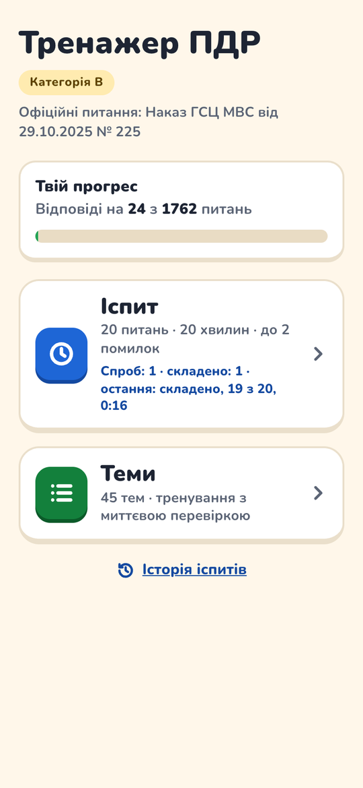
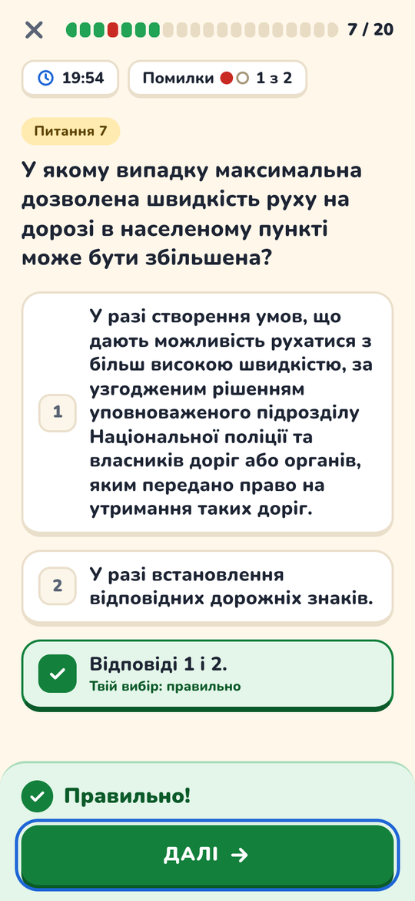
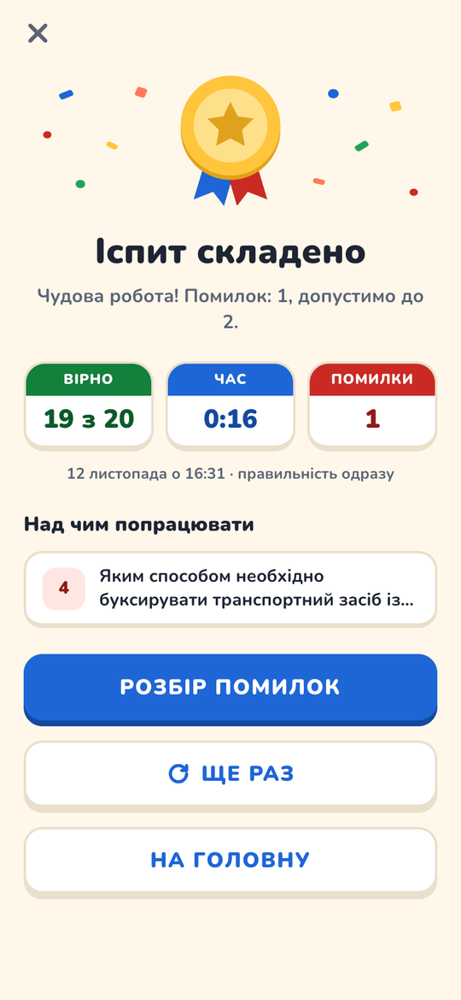
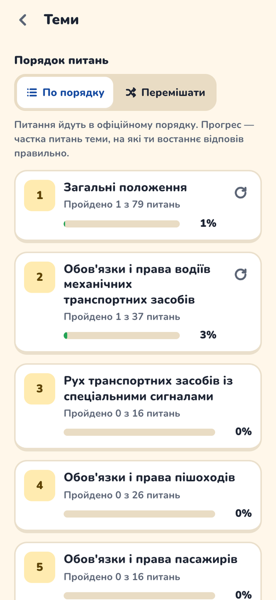

# Вільні ПДР

Безкоштовний тренажер теоретичного іспиту на права, категорія B. Офіційні питання Головного сервісного центру МВС, без підписок, реклами та реєстрації.

**Відкрити: [yehor-o.github.io/vilni-pdr](https://yehor-o.github.io/vilni-pdr/)**

<p>
  
  
  
  
</p>

## Чому це існує

Я готувався до теоретичного іспиту і шукав, де просто пройти двадцять тестових питань. Майже кожен сайт просив оформити підписку, і недешеву. При цьому самі питання й відповіді офіційні та відкриті: сервісний центр МВС публікує їх на своєму сайті.

Брати гроші за відкриті питання мені здалося неправильним, тому я зробив власний тренажер і виклав його для друзів і всіх, кому він стане в пригоді.

## Що вміє

- **Симуляція іспиту** як у сервісному центрі: 20 випадкових питань, 20 хвилин, третя помилка означає «не складено».
- **Тренування за темами:** 45 тем, по порядку або впереміш, із миттєвою перевіркою.
- **Розбір помилок** після кожного іспиту та історія спроб.
- **Робота над помилками:** питання з тем та іспитів, на які востаннє відповіли неправильно, збираються в окремий список і зникають із нього після правильної відповіді.
- **Марафон:** уся база категорії впереміш без таймера, з миттєвою перевіркою; спершу питання, на які ще не відповідали, далі нове коло.
- **Прогрес за кожною темою:** видно, де слабкі місця.
- **Працює без інтернету** після першого відкриття; можна додати на домашній екран телефона.
- **Жодних акаунтів і стеження:** прогрес зберігається лише у вашому браузері, сайт нічого нікуди не надсилає.

## Звідки питання

1762 питання для категорії B взято з офіційних документів, опублікованих на [сторінці ГСЦ МВС](https://hsc.gov.ua/index/poslugi/vidacha-posvidchennya-vodiya/pitannya-ta-ispit-z-pdr/): тестові питання й таблиця правильних відповідей, затверджені наказом від 29.10.2025 № 225.

Тексти питань і варіантів перенесено дослівно, разом з одруками оригіналу. Пояснень до відповідей немає, бо їх немає в офіційних документах.

## Застереження

Це неофіційний проєкт, не повʼязаний із Головним сервісним центром МВС. Питання на справжньому іспиті можуть змінитися з новим наказом раніше, ніж оновиться тренажер; актуальна редакція вказана на головному екрані.

Таблицю відповідей ГСЦ публікує сканом, тому її розпізнано двічі незалежно й звірено між собою, а вибірку питань перевірено вручну. Якщо все ж знайдете розбіжність з офіційним документом, [створіть issue](https://github.com/yehor-o/vilni-pdr/issues) з номером теми й питання.

На iPhone браузер Safari може стерти дані сайту, яким не користувалися близько тижня, а разом із ними і прогрес. Синхронізація з акаунтом, яка це виправить, є в планах.

## Плани

- Вхід і синхронізація прогресу між пристроями.
- Посилання на пункти ПДР біля кожного питання.
- Інші категорії (A, C, D, T): питання вже розібрані, бракує інтерфейсу.

Ідеї та виправлення вітаються через issues і pull requests.

## Підтримати

Вільні ПДР — відкритий проєкт без реклами, підписок і платних функцій, і таким залишиться. Якщо тренажер допоміг і хочеться подякувати авторові, є банка Monobank:

- посилання: [send.monobank.ua/jar/76ArKfTjMj](https://send.monobank.ua/jar/76ArKfTjMj)
- номер картки банки: `4874 1000 3605 1517`

Це добровільно: усе працює й без цього.

## Для розробників

React, Vite, TypeScript. Статичний сайт без сервера; дані лежать у `public/`.

```bash
npm install
```

```bash
npm run dev
```

```bash
npm test
```

```bash
npm run build
```

Структура:

| Шлях | Що там |
|---|---|
| `src/screens`, `src/components` | Екрани та спільні компоненти |
| `src/logic` | Чиста логіка іспиту й порядку питань, покрита тестами |
| `src/storage` | Єдиний модуль збереження прогресу (зараз `localStorage`) |
| `src/pwa` | Офлайн-режим та оновлення версії |
| `public/data`, `public/img` | Готові питання категорії B і стиснуті картинки |
| `data/` | Усі 63 розділи питань (`questions.json`) і відповіді (`answers*.json`) |
| `scripts/` | Імпорт з офіційних PDF |

Публікація на GitHub Pages відбувається автоматично після кожного push у `main`.

### Як оновити питання після нового наказу

Потрібен Python 3 з пакетами зі `scripts/requirements.txt`.

1. Завантажте з [сторінки ГСЦ](https://hsc.gov.ua/index/poslugi/vidacha-posvidchennya-vodiya/pitannya-ta-ispit-z-pdr/) PDF із питаннями та PDF із відповідями і покладіть їх у `data/source/` як `pdr-questions-nakaz225.pdf` та `pdr-answers-nakaz225.pdf` (або змініть назви у скриптах).
2. `python scripts/import_questions.py` розбирає питання й картинки в `data/questions.json` та `data/images/`.
3. `python scripts/validate_questions.py` перевіряє нумерацію, варіанти й привʼязку картинок.
4. Таблиця відповідей є сканом без тексту. Змінені розділи треба переписати у `data/answers.A.json` і `data/answers.B.json` двома незалежними проходами: скрипт збірки бере відповідь лише там, де обидва файли збігаються. Якщо вони розійшлися, третє читання можна записати в `data/answers.tiebreak.json`: воно зараховується, коли збігається з одним із проходів.
5. `python scripts/build_data.py` збирає `public/data/questions.b.json` і стискає картинки в `public/img/`.

Вихідні PDF і оригінали картинок у репозиторій не входять через розмір.

## Ліцензія

Код поширюється за ліцензією [MIT](LICENSE). Тексти питань і зображення до них є офіційними матеріалами Головного сервісного центру МВС України і ліцензією MIT не охоплюються.

---

## In English

Vilni PDR ("Free Traffic Rules") is a free, open-source trainer for the Ukrainian driving-licence theory exam, category B. It uses the official question bank published by the Main Service Centre of the Ministry of Internal Affairs, runs entirely in the browser, works offline, and needs no account. The interface is in Ukrainian. Code is MIT-licensed; the questions and images are official government materials.
